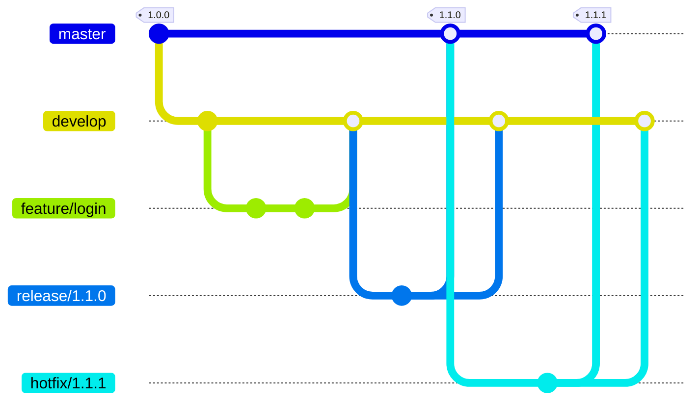

# GitFlow pour Visual Studio — Tutoriel

🌐 [English](en/README.md) · **Français**

Démarrez et terminez vos branches `feature/`, `release/` et `hotfix/` sans quitter Visual Studio. L'extension respecte strictement le [Gitflow Workflow d'Atlassian](https://www.atlassian.com/git/tutorials/comparing-workflows/gitflow-workflow).

Par défaut, les branches sont mergées en local. Si vos branches sont protégées, vous pouvez à la place passer par des Pull Requests sur GitHub ou Azure DevOps.

**Sommaire du tutoriel**

| Page | Contenu |
|---|---|
| **Accueil** (cette page) | Présentation, schéma du modèle, démarrage rapide |
| [Guide d'utilisation](guide.md) | Installation, fenêtre GitFlow, features, releases, hotfixes, commit, conflits, paramètres |
| [Mode Pull Request](pull-requests.md) | Terminer par PR sur GitHub / Azure DevOps, suivi, tag après merge, finalisation |
| [Référence et dépannage](reference.md) | Règles, clés de configuration, commandes git, problèmes courants |

> Ce tutoriel existe aussi sous forme de petit site web : ouvrez [`index.html`](index.html) dans un navigateur.

## Le modèle appliqué

- **Features** : partent de `develop` et y reviennent. Elles ne touchent jamais `master`.
- **Release** : part de `develop`, est mergée dans `master` (qui reçoit le tag de version), puis dans `develop`.
- **Hotfix** : la seule branche qui part de `master`. Elle revient dans `master` (tag) et dans `develop`.

## Ce que fait l'extension

| | |
|---|---|
| **Menu et fenêtre** | Démarrer, pousser et terminer depuis **Extensions > GitFlow** ou la fenêtre GitFlow. |
| **Sécurité** | Refus s'il y a des modifications non commitées, arrêt sur conflit avec reprise, jamais de `push --force`, `reset --hard` ni de branche non mergée supprimée. |
| **Pull Requests (option)** | Branches protégées ? Terminez par PR sur GitHub ou Azure DevOps : message généré, suivi, tag créé après le merge. |
| **Commit** | Liste des modifications et message de commit généré depuis git (fichiers, lignes, tickets), modifiable. |
| **Dépendances** | Seulement Visual Studio et Git for Windows. Pas de git-flow, pas de `gh` ni d'`az` : vos identifiants git suffisent. |
| **Journal** | Chaque commande git exécutée apparaît dans **Sortie > GitFlow**, avec son code retour. |

## Démarrage rapide

### Prérequis

- **Visual Studio 2022 17.14+** ou **Visual Studio 2026**.
- **Git for Windows** (installé avec Visual Studio) : la commande `git` doit être dans le PATH.
- Une solution ouverte **dans un dépôt Git** qui contient au moins un commit.

### Premiers pas

1. **Installez l'extension** : fermez Visual Studio, double-cliquez sur `GitFlow.VSExtension.vsix`, validez, relancez Visual Studio. → [Détails](guide.md#1-installation)
2. **Ouvrez la fenêtre GitFlow** : **Extensions > GitFlow > Fenêtre GitFlow**. Elle s'ouvre en onglet à côté de Git Changes.
3. **Initialisez** le dépôt : bouton *Initialiser GitFlow…*, vérifiez les noms proposés (`master`, `develop`, `feature/`…), OK. La branche `develop` est créée.
4. **Démarrez une feature** : type *Feature*, nom `login`, *Démarrer*. Vous êtes sur `feature/login`.
5. **Travaillez et commitez** depuis la section *Commit* de la fenêtre. Le message est proposé, modifiez-le si besoin, puis *Commiter*.
6. **Terminez** : *Terminer…* sur la ligne de la branche. Elle est mergée en `--no-ff` dans develop puis supprimée, et vous revenez sur develop.

> **Pour aller plus loin** Le [guide complet](guide.md) couvre les releases, les hotfixes, les conflits et les paramètres. Si `master` et `develop` sont protégées sur votre serveur, lisez [le mode Pull Request](pull-requests.md).
