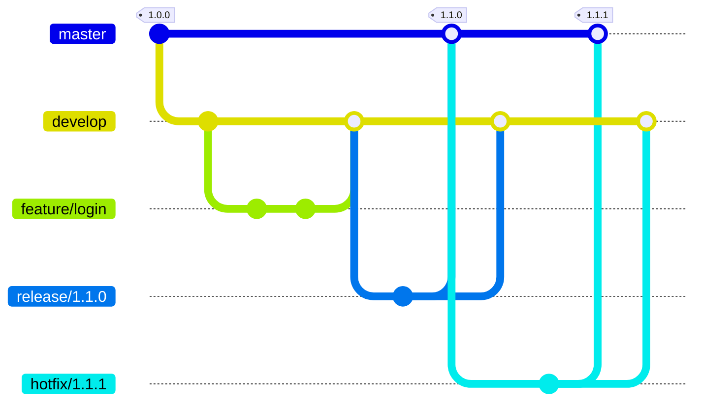

# GitFlow for Visual Studio — Tutorial

🌐 **English** · [Français](../README.md)

Start and finish your `feature/`, `release/` and `hotfix/` branches without leaving Visual Studio. The extension strictly follows the [Atlassian Gitflow Workflow](https://www.atlassian.com/git/tutorials/comparing-workflows/gitflow-workflow).

By default, branches are merged locally. If your branches are protected, you can use Pull Requests on GitHub or Azure DevOps instead.

**Contents**

| Page | Content |
|---|---|
| **Home** (this page) | Overview, model diagram, quick start |
| [User guide](guide.md) | Installation, GitFlow window, features, releases, hotfixes, commit, conflicts, settings |
| [Pull Request mode](pull-requests.md) | Finishing through PRs on GitHub / Azure DevOps, tracking, tag after merge, completing the branch |
| [Reference and troubleshooting](reference.md) | Rules, configuration keys, git commands, common problems |
| [GitFlow for VS Code](vscode.md) | The same extension in Visual Studio Code: installation, panel, commands |

> This tutorial is also available as a small website: open [`index.html`](index.html) in a browser.

## The model

- **Features** start from `develop` and are merged back into it. They never touch `master`.
- **Release** starts from `develop`, is merged into `master` (which gets the version tag), then into `develop`.
- **Hotfix** is the only branch that starts from `master`. It is merged into `master` (tag) and into `develop`.

## What the extension does

| | |
|---|---|
| **Menu and window** | Start, push and finish from **Extensions > GitFlow** or the GitFlow window. |
| **Safety** | Refuses to run with uncommitted changes, stops on conflicts and can resume, never runs `push --force` or `reset --hard`, never deletes an unmerged branch. |
| **Pull Requests (option)** | Protected branches? Finish through a PR on GitHub or Azure DevOps: generated message, tracking, tag created after the merge. |
| **Commit** | List of changes and a commit message generated from git (files, lines, tickets), editable. |
| **Dependencies** | Only Visual Studio and Git for Windows. No git-flow, no `gh`, no `az`: your git credentials are enough. |
| **Log** | Every git command appears in **Output > GitFlow**, with its exit code. |

## Quick start

### Requirements

- **Visual Studio 2022 17.14+** or **Visual Studio 2026**.
- **Git for Windows** (installed with Visual Studio): the `git` command must be on the PATH.
- A solution opened **in a Git repository** that has at least one commit.

### First steps

1. **Install the extension**: close Visual Studio, double-click `GitFlow.VSExtension.vsix`, confirm, restart Visual Studio. → [Details](guide.md#1-installation)
2. **Open the GitFlow window**: **Extensions > GitFlow > GitFlow Window**. It opens as a tab next to Git Changes.
3. **Initialize** the repository: *Initialize GitFlow…*, check the suggested names (`master`, `develop`, `feature/`…), OK. The `develop` branch is created.
4. **Start a feature**: type *Feature*, name `login`, *Start*. You are now on `feature/login`.
5. **Work and commit** from the *Commit* section of the window. A message is suggested; edit it if needed, then *Commit*.
6. **Finish**: *Finish…* on the branch row. It is merged with `--no-ff` into develop, then deleted, and you are back on develop.

> **Going further**: the [user guide](guide.md) covers releases, hotfixes, conflicts and settings. If `master` and `develop` are protected on your server, read [Pull Request mode](pull-requests.md).
